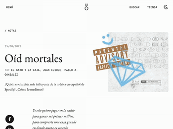
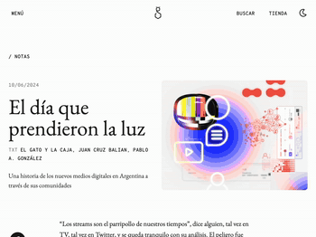

# Juan Ignacio Cuiule

Software engineer based in Buenos Aires. I build web products, interactive narratives, and research tools with a focus on careful systems design and thoughtful frontend engineering.

I work at [@elgatoylacaja](https://github.com/elgatoylacaja), an Argentine science communication organization that publishes books, essays, podcasts, interactive pieces, and digital experiments exploring science, culture, and society. My work there sits somewhere between product engineering, creative technology, and data-driven storytelling.

I'm currently looking to focus on product engineering — TypeScript, React, Next.js — and the long, unglamorous work of making complex systems feel simple.

---

## Projects

### [experiment-hub](https://github.com/juancuiule/experiment-hub)

An adaptive experiment runner for behavioral research. Researchers face a real tradeoff: drag-and-drop tools like Qualtrics fall apart on complex adaptive designs (multi-level loops, weighted random assignment, composite branching across responses), and custom code makes every new study a new project. experiment-hub sits in between — a typed graph schema for branching, looping, and randomized flows, with a React participant UI and a **static validator that catches misconfigured experiments at build time** rather than mid-study.

The flow engine is framework-agnostic and unit-tested. The graph supports `branch`, `fork`, `path`, `loop`, and `checkpoint` nodes; conditions compose via `and` / `or` / `not`; data flows through a small prefix notation (`$$` experiment-wide, `@` loop item, `#` for-each item) used uniformly across conditions, answer piping, and conditional rendering. It's a side project I work on for its own sake — but it's where I push hardest on what I think well-designed software looks like.

`TypeScript` · `Next.js` · `Zustand` · `Zod` · `Vitest`

### Labs — *An internet-based behavioral research lab*

[Labs](https://elgatoylacaja.com/tag/labs) is El Gato y La Caja's platform for online behavioral-science studies. The experiments are usually complex, branching, randomized surveys with mixed stimuli and response components designed for real academic research, mostly in the behavioral sciences.

The challenge is balancing correctness with usability: the data has to be reliable enough for publication, while the experience still needs to feel smooth and engaging enough that participants actually finish the study. A lot of my work revolves around building systems that let researchers express complicated experimental logic without every study becoming a one-off codebase.

Beyond the platform itself, I also worked on data analysis pipelines and exploratory analysis using Jupyter notebooks, contributing to research projects that later became published scientific papers.

`TypeScript` · `React` · experimental flow systems · data collection tooling

### [Oíd Mortales](https://elgatoylacaja.com/notas/oid-mortales) — *El Gato y La Caja*

A graph-driven scrollytelling piece exploring who the most "influential" Spanish-language artist on Spotify is — measured first by followers, then popularity, then Bourdieusian network centrality. Each scroll step transforms the same graph of 864 artists and 6,400 collaborations, recomputing layouts and emphasis as the reader moves through the argument. Built with the eglc team; I did the data work and the interactive frontend.

`React` · `D3` · `force-graph` · scroll-linked transitions

### [El día que prendieron la luz](https://elgatoylacaja.com/notas/el-dia-que-prendieron-la-luz) — *El Gato y La Caja*

Another graph-based scrollytelling piece, with a different visual treatment and narrative structure. Same underlying problem: getting a complex network to feel legible as it changes under the reader's scroll.

`React` · `D3` · scroll-linked transitions

### eglc-renders — *El Gato y La Caja*

A 3D render service for the book catalogue. HTTP API that takes a list of book slugs and layout parameters, hashes them, and (on a cache miss) spawns Blender headlessly to render six camera frames per request. Each frame goes through separate color and shadow passes, which ImageMagick composites and tiles into a single PNG before streaming it back. The whole pipeline — Fastify server, Blender Python script driving UV mapping and per-armature dimensions from a JSON catalogue, ImageMagick compositing, content-addressed caching — is the kind of thing I like building: not glamorous, but a clean seam through unrelated tools. The frontend that drives it is a small UI prototyped with v0. *(Code lives in the eglc org — will be made public.)*

`TypeScript` · `Fastify` · `Blender (Python)` · `ImageMagick`

## Other experiments
- [**eglc-moravec**](https://github.com/juancuiule/eglc-moravec) — Frontend for Moravec, El Gato y La Caja's flagship behavioral experiment platform.
- [**random**](https://github.com/juancuiule/random) — A personal sandbox for generative art. Includes the code behind my [fxhash](https://www.fxhash.xyz/) drops (*bouba*, *gelatina*, *fxnets*), along with sketches, talk slides, and the scaffolding I reuse across projects. Structured as a pnpm workspace, each project ships independently.

---

### Teaching

I studied Systems Engineering at UTN-FRBA and now work there as a teaching assistant. I currently help with [Paradigmas de Programación](https://github.com/pdep-lunes), and previously assisted in [Técnicas Avanzadas de Programación](https://github.com/tadp-utn-frba) — courses focused on the design principles behind well-structured software and maintainable systems.

### Organizations

[@elgatoylacaja](https://github.com/elgatoylacaja) · [@pdep-lunes](https://github.com/pdep-lunes)

---

### Elsewhere

[Email](mailto:juancuiule@gmail.com) · [LinkedIn](https://www.linkedin.com/in/juancuiule) · [Twitter](https://twitter.com/juancuiule)
